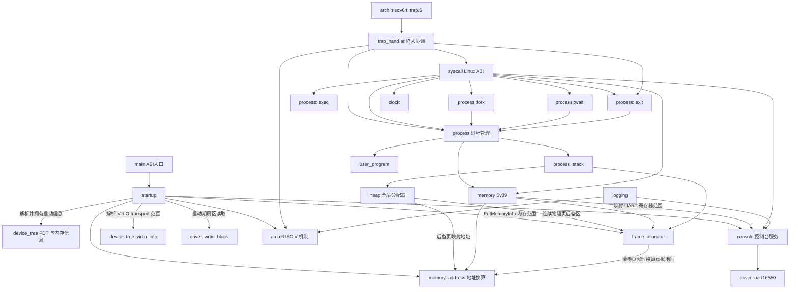

# 模块职责与依赖

本文说明当前代码的职责边界、实际依赖和正在推进的重构方向。它描述现有实现，不把规划中的接口写成已经具备的能力。

## 顶层模块

| 模块 | 职责 | 主要依赖 |
| --- | --- | --- |
| `src/main.rs` | 声明内核领域模块，导出汇编使用的 `kernel_main` 入口并定义 panic handler | `startup`、RISC-V 架构入口 |
| `src/device_tree` | 校验和遍历 FDT，并在无堆阶段提取内存、控制台和 VirtIO transport 初始化所需的平台数据 | Rust 核心库 |
| `src/console.rs` | 提供控制台字节输入输出及格式化服务，供内核日志和 syscall 使用 | `driver` 中的控制台能力接口 |
| `src/driver` | 定义驱动共享接口，并提供 NS16550 UART 与 VirtIO MMIO 块设备驱动 | QEMU `virt` 设备 binding、VirtIO 规范与寄存器约定 |
| `src/arch/riscv64` | 提供低地址启动跳板与早期 Sv39 页表初始化、陷入帧、SBI 和定时器等 RISC-V 机制 | RISC-V 寄存器与固件调用约定 |
| `startup` | 解析 FDT 启动信息并把 UART 范围交给控制台初始化，初始化页帧分配器和堆，再读取 VirtIO 测试扇区并启动入口进程 | `device_tree`、`console`、`driver`、分配器、进程和架构初始化接口 |
| `user/` | 独立构建的用户态运行库和示例程序；默认 `init` 作为 PID 1 启动并监督 shell，shell 可前台运行嵌入式命令程序；`user_entry!` 将 `main` 的 `i32` 返回值作为进程退出状态 | 使用 Linux RISC-V syscall 约定；init 的派生、启动和重启策略以及 shell 的命令策略留在用户态，不由内核硬编码 |

## 内核领域模块

| 模块 | 单一职责 | 资源所有权或接口边界 |
| --- | --- | --- |
| `heap` | 管理内核对象使用的字节堆，并实现全局分配器 | 初始化时从页帧分配器取得连续物理页作为固定堆后备区，通过 `memory` 地址接口取得高半区虚拟地址；为 `Vec` 等 `alloc` 容器提供字节分配 |
| `frame_allocator` | 根据 FDT 中的 RAM 范围分配和回收物理页帧 | 使用固定 BSS 区间表保存物理范围元数据，不依赖堆；排除内核映像、DTB 和固件保留范围；清零时通过 `memory` 地址接口访问页帧 |
| `memory` | 定义地址空间共享的映射输入与统一错误类型，并提供页帧内容复制 | 操作由 `address_space`、`user_access` 和 `page_table_log` 子模块直接提供；不经 `memory/mod.rs` 纯转发；地址空间机制不拥有用户栈、程序镜像或页表目标页 |
| `memory::address` | 定义 Sv39 规范地址规则、低半部用户地址上界、内核直接映射及内核映像 VMA/LMA 换算 | 纯地址计算，不访问页表或分配器；调用方负责保证所访问物理范围已映射；内核其他模块直接依赖此模块，不经 `memory` 转发 |
| `memory::page` | 定义 4 KiB 基础页大小、对齐判断及页边界取整 | 纯算术模块，供页帧分配器、页表、地址空间和进程栈共用；不依赖这些调用方 |
| `memory::address_space` | 创建、切换、校验和销毁进程的 Sv39 地址空间 | `AddressSpace` 值独占根页表树；单个创建失败时回收部分页表树，通过 `page_table` 建立映射，通过页帧分配器取得和归还页表页 |
| `memory::page_table` | 编码 Sv39 页表项、建立 4 KiB 映射并激活根页表 | 只管理页表机制；地址空间生命周期由 `address_space` 决定 |
| `memory::page_table_log` | 遍历现有页表并把映射合并成诊断日志 | 只读页表；不创建或释放映射 |
| `memory::user_access` | 在短暂设置 `sstatus.SUM` 的窗口内访问已验证的用户地址 | 只执行单次内存读写；范围校验由 syscall 调用路径负责 |
| `trap_handler` | 接收架构陷入现场并分类陷入原因，将用户环境调用转交给 syscall 层 | 依赖 `arch::riscv64::trap`、`syscall` 和 `process`；不直接访问进程表、页表或设备 |
| `process` | 管理进程表、状态、轮转调度和进程资源的最终回收 | 持有追加式 `Vec<Process>` 与稳定 `ProcessId`；每个进程独占 `ProcessResources`，包含地址空间、镜像和两种栈；陷入帧固定保存在内核栈顶下方，由栈布局推导地址；不依赖 syscall ABI |
| `process::creation` | 创建启动阶段装入的独立用户进程 | 按顺序准备镜像、用户栈、内核栈和地址空间，全部成功后发布进程对象；与 `fork` 共享进程槽位预留及内核映像布局准备 |
| `process::exec` | 用新的嵌入式 ELF 程序替换当前进程的用户态映像、参数栈和地址空间 | 保留 PID、父子关系及当前内核栈；先准备新映像、带 `argc/argv` 的用户栈和地址空间，再切换并回收旧资源 |
| `process::fork` | 复制当前进程的用户镜像、用户栈和用户现场，创建子进程 | 子进程独占复制后的页帧、内核栈和地址空间；构造完整后才追加到进程表；将资源失败和 PID 耗尽分类交给 syscall 转换 ABI 错误码 |
| `process::wait` | 管理父子关系、阻塞等待、退出状态写回、孤儿重新托管和子进程资源回收 | 按稳定 `ProcessId` 匹配子进程；非 PID 1 父进程退出时将子进程交给 PID 1；只在父进程地址空间中写入 syscall 已验证的 wait 状态地址 |
| `process::exit` | 标记正常退出或异常终止，发布退出状态并通知父子关系管理 | 调用 `wait` 处理父进程唤醒和孤儿关系，再交给 `process` 调度器切换；资源实际回收由调度器在切换到安全栈后执行 |
| `process::stack` | 分配进程内核栈和用户栈的页帧，并在资源销毁时归还 | 内核栈需要连续页帧并映射到高半区；`KernelStack` 提供固定位置的陷入帧地址；每张进程页表映射所有可能仍在使用的内核栈，以支持切换期间继续运行；用户栈允许离散页帧；不决定调度策略 |
| `syscall` | 将 Linux RISC-V syscall 转换为内核行为，并协调所需子系统完成调用 | 负责 ABI 参数、用户指针范围验证、`execve` 参数复制和 Linux 错误码；通过窄接口调用进程、内存、时钟和控制台能力，不直接访问进程表 |
| `user_program` | 校验构建生成的程序清单、解析嵌入式 ELF 并装载 `PT_LOAD` 段 | ELF 字节嵌入内核构建产物；`user_program::elf` 只解析 ELF 头和程序头，外层分配、清零并复制页帧；`LoadedUserProgram` 持有入口、页权限及镜像页帧 |
| `clock` | 提供内核启动后的单调时间值 | 读取架构计时源并转换成内核时间值，不定义用户 ABI 布局 |
| `logging` | 过滤并格式化内核诊断记录 | 通过 `console` 输出，并读取平台计时源 |
| `console` | 为日志和 syscall 提供字节输入输出及格式化写入接口，并暴露当前控制台的 MMIO 范围 | 通过 `driver::ConsoleDevice` 契约调用当前 UART 实现 |
| `driver::uart16550` | 轮询访问 FDT 选出的 NS16550 兼容 UART | 启动时提供的 MMIO 范围和 NS16550 寄存器布局；实现 `driver::ConsoleDevice` |
| `driver::virtio_block` | 探测现代 VirtIO MMIO 块设备，配置单个 split virtqueue 并轮询读取 512 字节扇区 | 启动层提供 FDT 解析出的 MMIO 范围和 DMA 静态区的物理地址；不依赖 FDT 或内核内存模块 |

## 关键数据类型的归属

结构体按其表达的概念和维护的不变量归属，不按“被谁使用”简单搬进调用方模块。当前主要数据类型如下：

| 类型 | 所属模块 | 归属理由与边界 |
| --- | --- | --- |
| `FdtHeader`、`FdtBlob`、`FdtStructureEvent` | `device_tree::fdt` | 描述 FDT 二进制格式和借用式解析视图；不携带内核策略或分配器状态 |
| `FdtMemoryInfo`、`FdtMemoryInfoError` | `device_tree::memory_info` | 把 FDT 内容整理成启动阶段需要的自有值，并在无堆状态下校验容量和范围 |
| `FdtDeviceRegisterRegion` | `device_tree` | 表示从 FDT `reg` 属性解码出的设备寄存器物理范围，供控制台和 VirtIO 信息解析结果共用 |
| `PhysicalMemoryRegion` | `device_tree::memory_info` | 是 `FdtMemoryInfo` 输出的物理内存范围描述；页帧分配器本就消费 `FdtMemoryInfo`，无需为单个简单值额外建立通用模块 |
| `PhysicalFrame`、`PhysicalFrameRun` | `frame_allocator` | 表达页帧及连续页帧的独占所有权；只有内核子系统可传递这些令牌 |
| `PageTable` | `memory::page_table` | 表示与 Sv39 硬件格式对齐的页表页 |
| `UserImageMapping`、`UserStackMapping` | `memory` | 描述地址空间初始化需要的映射输入；进程拥有镜像和栈，memory 只建立映射 |
| `KernelMemoryLayout`、`KernelSectionRange` | `memory` | 描述链接器提供的内核各段虚拟和物理边界；memory 校验页对齐及顺序，并按段设置页权限 |
| `KernelStack`、`UserStack`、`Process`、`ProcessState`、`ProcessId`、`ProcessResources` | `process` 及其 `stack` 子模块 | `Process` 持有身份、父进程、状态和退出码；`ProcessResources` 集中拥有可回收的地址空间、镜像和栈资源；陷入帧位于内核栈固定位置，不单独保存其地址 |
| `UserMemoryRanges` | `memory` | 由进程管理提供给 syscall 上下文，区分可读的程序范围、可写程序范围和用户栈，避免 syscall 向 ELF 只读页写入 |
| `TrapFrame`、`TaskContext` | `arch::riscv64::trap`、`arch::riscv64::context` | 布局必须与对应汇编偏移一致，属于架构现场机制，不属于调度策略 |
| `MonotonicTime` | `clock` | 表示内核内部时钟读数，不暴露用户 ABI 布局 |
| `LinuxTimespec`、`SyscallContext` | `syscall` | 将 Linux ABI 时间布局和当前调用的用户内存访问范围限制在 syscall 边界 |
| `ProcessWaitRequest`、`WaitDecision` | `process::wait` | 保存进程内部的阻塞等待条件，并描述等待请求应立即返回、阻塞或报告没有匹配子进程 |
| `ConsoleDevice`、`MmioRegion` | `driver` | 定义 UART 字节收发契约和设备寄存器物理范围；控制台服务不依赖 UART 寄存器布局 |

内核子模块之间的协作接口优先采用父模块范围的可见性（`pub(super)`），仅当入口需要由 crate 根调用、宏展开需要访问，或类型确实构成稳定公共解析接口时才使用更宽可见性。这使调用关系可从模块树看出，并避免把内部资源令牌伪装成通用公共 API。

## 当前依赖关系

箭头表示“左侧调用或使用右侧”。陷入协调器只把用户环境调用转给 syscall 层；syscall 层取得当前用户内存范围，并按调用需要协调进程、内存、时钟或设备能力。进程模块不依赖 Linux syscall ABI。

## 依赖约定

- 架构模块提供机制，不决定批处理、进程选择或 Linux syscall 行为。
- `trap_handler` 是运行时陷入路由层：架构汇编保存和恢复现场并调用陷入协调器；协调器识别原因，将 U-mode 环境调用交给 syscall 处理函数，将定时器与用户异常交给进程管理。它不持有进程状态或实现 syscall ABI。
- `syscall` 是 Linux ABI 到内核能力的适配与协调层：它解码调用、校验参数，直接调用所需的进程、内存、时钟或控制台接口，并负责返回值和用户现场推进。它不直接访问进程表或实现调度策略。
- `process` 拥有进程状态、资源和调度策略；`creation`、`fork`、`exec`、`wait`、`exit` 分别管理初始创建、复制创建、映像替换、父子等待和退出状态变化。它们只提供内核语义接口，不解析 Linux syscall 编号、参数或 errno。
- 页帧分配器管理物理页，不依赖堆、地址空间、进程或用户程序；其元数据使用固定容量区间表，避免堆初始化前的循环依赖。清零页帧时仅依赖 `memory::address` 的纯地址换算，不调用页表生命周期或地址空间接口。
- `memory::address` 负责 Sv39 地址规则与内核地址换算，不验证映射是否已建立。调用方必须根据启动阶段和地址空间契约保证地址可访问；需要地址换算的内核模块直接调用该子模块，不通过 `memory` 增设纯转发函数。
- `memory::page` 只依赖 Rust 核心整数运算，集中维护基础页大小和页对齐规则；堆对象对齐仍由 `heap` 按其任意对齐语义单独处理。
- 堆只管理对象字节分配，初始化时从页帧分配器取得连续物理页，再以高半区直接映射虚拟地址管理对象；页帧所有权仍由堆持有，堆当前固定为 256 KiB。
- `memory` 管理映射，不拥有映射目标所指向的程序镜像和进程栈页帧；进程页表将 FDT RAM 映射到高半区直接映射窗口，UART MMIO 范围由 `console` 提供并单独映射。
- `process` 决定何时创建、切换、结束和回收进程；`process::stack` 只管理栈页帧所有权。地址空间由 `AddressSpace` 值表达，不再由 memory 模块的全局索引表间接管理。
- `syscall` 是 Linux ABI 边界。ABI 编号和错误码应留在该边界，不散布到调度、内存和设备模块。
- 当两个子系统需要互相调用时，应优先把共享契约放进窄的数据接口，避免继续扩大双向依赖。
- `main` 只负责启动编排；FDT 解析、页表细节和进程状态转换分别留在各自子系统。
- `device_tree::fdt` 只依赖核心库并返回借用式原始视图；`device_tree::memory_info` 在无堆阶段把初始化信息复制到固定容量值中。页帧分配器消费 `FdtMemoryInfo` 中的物理范围，不反向依赖内核分配器或日志。
- `device_tree::console_info` 在无堆阶段从 `/soc` 下提取 NS16550 UART 的寄存器范围；`startup` 在首次日志输出前把寄存器范围交给 `console::initialize`，控制台模块配置当前 UART 驱动；解析器不依赖驱动，驱动也不解析 FDT。
- `device_tree::virtio_info` 在无堆阶段收集 `/soc` 下启用的 `virtio,mmio` transport 范围；`startup` 将候选范围交给 `driver::virtio_block`，由驱动读取设备 ID 并选择块设备。启动层负责把驱动静态 DMA 区域的高半区虚拟地址换算为物理地址，再通过窄参数传入驱动；驱动不依赖 FDT 或内核内存模块。
- 当前 VirtIO 块驱动只在首个用户进程启动前使用静态 DMA 队列轮询读取一个扇区；它依赖引导页表保留的低地址 MMIO 恒等映射。进程页表尚未映射 VirtIO 寄存器，运行时块 I/O、并发请求、设备中断和文件系统均未实现。QEMU 启动脚本生成并挂载一个仅含测试签名的原始镜像。
- Linux ABI 的数据布局由 `syscall` 持有；`clock` 只返回内部时间值，避免内核机制层依赖 syscall ABI。
- 启动顺序必须先解析并校验 DTB、提取 RAM/固件保留范围和 DTB 自身范围，再初始化页帧分配器，最后从页帧分配器取得堆后备页；页帧分配器的元数据不能通过堆分配。

## 本轮重构与后续边界

早期阶段把原先混合用户态启动与栈生命周期的 `user_mode.rs` 移至进程管理模块，并将栈 backing 收拢到栈子模块；syscall 使用进程分发前提供的地址范围，不再反向查询进程表。页表机制保留在 `memory`，只读映射诊断拆到 `memory::page_table_log`。启动初始化从 `main.rs` 移入 `startup`，入口文件只保留 ABI 入口和 panic handler。这些拆分保留既有控制流和资源生命周期。

此前将导出的 `supervisor_trap_handler` 和运行时陷入路由移至 `trap_handler`，并明确 syscall 层负责协调 ABI 操作。陷入处理器把 U-mode 环境调用交给 `syscall`；syscall 直接调用进程、内存、时钟和设备接口，处理返回现场及进程控制，不再通过 `SyscallOutcome` 中转。汇编入口符号保持 `supervisor_trap_handler` 不变，因此不需要改变 `trap.S` 的调用约定。

本轮把进程创建相关的 `fork` 从通用 `creation` 中分离到 `process::fork`，把正常退出和异常终止收拢到 `process::exit`，并让 syscall 直接调用 `process::fork`、`process::wait` 和 `process::exit` 的窄接口。`ProcessWaitRequest` 与 `WaitDecision` 收拢到 `process::wait`；进程表和调度器继续由 `process` 核心模块持有，退出模块只改变生命周期状态并请求调度，资源回收仍由调度器在切换地址空间和栈后负责。这样 ABI 参数和 errno 留在 syscall，父子关系与资源生命周期留在进程子模块。

本轮将 `memory` 从单文件模块整理为 `memory/mod.rs` 目录模块，以便与已有的页表日志子模块共同组织后续内存职责。进程栈模块仍负责栈的页帧分配、所有权和释放；`memory` 仅接收栈映射描述并建立页表映射，避免把进程资源生命周期移入地址空间机制。

本轮继续将 `memory` 按机制边界拆为 `address_space`、`page_table` 和 `user_access`：前者编排由 `AddressSpace` 值拥有的页表树的创建、切换及销毁；`page_table` 集中处理 Sv39 PTE 和 `satp`；`user_access` 仅封装 SUM 开关与单次用户内存读写。`memory/mod.rs` 保留进程和 syscall 使用的接口、映射输入类型及统一错误说明，页表诊断仍由 `page_table_log` 只读遍历。

本轮新增 `memory::page` 统一 4 KiB 页大小、对齐判断及向上/向下页对齐；页帧分配器、地址空间和进程栈直接使用该叶子模块。Sv39 规范地址转换及用户低半部上界收拢到 `memory::address`，页表诊断也从该处取得规范地址处理。地址换算不再经 `memory/mod.rs` 的转发函数，调用方直接依赖纯计算模块；地址空间创建等有意作为内存子系统接口保留在 `memory` 门面中。

第 32 阶段引入单进程创建器，第 43 阶段移除用户镜像和进程记录的固定数量上限。第 44 阶段将进程记录改为拥有资源的 `Process` 对象：创建器先预留容器容量，再准备镜像、用户栈、内核栈和地址空间，最后一次性发布对象；创建失败时局部所有者回收已取得资源。退出后，调度器先切换地址空间，再回收已退出进程的页表、镜像和用户栈；内核栈延迟到运行在另一栈后释放。最后一个进程退出时，回收器先切换到引导栈和保留的引导页表，再释放最后一组资源。第 45 阶段加入 fork 式进程复制和 `wait4` 等待，退出状态由父进程收集；PID 仍追加分配且不复用。

第 46 阶段加入受限 `execve`：当时只查找 `/bin/<程序名>` 对应的构建期嵌入程序。第 47 阶段在用户态加入 `init`：首个进程作为 PID 1，循环 fork 子进程、exec shell、wait 任意子进程并在 shell 退出后重新启动；内核将其他父进程留下的孤儿重新托管给 PID 1，init 负责通过 `waitpid(-1)` 收集退出状态。第 48 阶段让 shell 通过 `fork`、`exec` 和针对子 PID 的 `waitpid` 前台运行嵌入式程序。第 49 阶段将构建期嵌入的原始镜像改为 ELF，内核解析静态 RV64 `ET_EXEC` 的 `PT_LOAD` 段并按页权限映射。第 50 阶段让 `execve` 校验并复制 `argv`，在新用户栈构造 `argc`、参数指针、空 `envp` 和 `AT_NULL`；shell 支持无引号、按空格拆分的参数。当前没有文件系统，用户库和 shell 直接按程序名查找嵌入清单，不再合成 `/bin/` 伪路径。当前仍不支持非空 `envp`、动态链接、PIE、重定位或文件系统加载；早期 batch 启动模式已移除，后续进程由用户态按需创建。

当前启动入口 `_start` 与引导页表、引导栈位于低地址；引导汇编清零各段的物理装载范围，建立临时 Sv39 映射，再切换到高半区 `kernel_main`。内核 `.text`、`.rodata`、`.data` 和 `.bss` 的 VMA 为 `0xffffffc000000000 + LMA`，并按页边界分别映射为 `SR-X`、`SR--`、`SRW-` 和 `SRW-`。进程页表将 FDT RAM 映射到 `0xffffffc000000000 + PA` 的高半区直接映射窗口，并按高 VMA/低 LMA 映射内核段、启动栈和所有进程内核栈；内核代码、堆、页帧和页表通过高半区虚拟地址访问，物理地址仅用于页表项、`satp` 和资源记录。共享内核栈映射使调度器切换 `satp` 后仍能完成当前陷入处理。用户 ELF 的 `PT_LOAD` 页按段权限映射为 `UR-X`、`UR--` 或 `URW-`，用户栈映射为 `URW-`，均位于 Sv39 低半部；用户映像从 `0x40000000` 开始，物理页由进程拥有且可以不连续。`make inspect-kernel-elf` 检查低地址入口、启动段恒等布局及内核主体 VMA/LMA 偏移。临时启动页表按 QEMU `virt` 的单 hart、128 MiB RAM 环境用 1 GiB 叶子覆盖低设备窗口、RAM 低地址和高半区别名；进程页表不再建立 RAM 低地址恒等映射，UART MMIO 仍按设备物理地址单独映射。

此前将原先过于宽泛的 `boot` 顶层模块重命名为 `device_tree`，并把 `info.rs` 明确命名为 `memory_info.rs`；启动编排曾位于 `kernel::startup`。QEMU UART 曾从 `arch::riscv64` 移至 `device` 模块。本轮将具体硬件实现归入 `driver`，并将控制台服务保留在独立的 `console` 模块：`driver::ConsoleDevice` 表达 UART 的最小字节收发契约，日志和 syscall 通过 `console` 使用服务接口，具体 NS16550 寄存器访问集中在 `driver::uart16550`；VirtIO 块设备实现位于 `driver::virtio_block`。随后由 `device_tree::console_info` 读取 QEMU `virt` FDT 中 `/soc` 子设备的 UART `reg` 范围，启动阶段先完成这项解析和控制台初始化，再输出日志；UART 物理地址不再写死在驱动中。当前仍只支持空 `ranges` 的 `/soc` 和 NS16550 兼容设备，尚未解析 `/chosen/stdout-path`、总线地址转换或建立通用设备发现/注册框架。另继续明确数据与机制/ABI 的归属：`PhysicalMemoryRegion` 留在 `device_tree::memory_info`，时钟返回内核自己的 `MonotonicTime`，Linux `timespec` 布局留在 syscall 边界。没有为了文件大小进行机械拆分，页表映射契约仍由 `memory` 统一维护，进程对象拥有自己的栈和镜像资源。

当前仍有明确的重构工作：

1. 地址空间规划已记录在第 33 阶段；第 34 阶段分离用户镜像虚拟地址与 RAM 恒等映射，第 35 阶段按页边界落实内核段权限，第 41 阶段实现低地址入口、早期 Sv39 映射及高 VMA/低 LMA 内核主体。进程页表按 FDT 描述的 RAM 建立高半区直接映射，低地址 RAM 恒等映射只保留在启动页表中；后续可继续审查启动阶段低地址映射的范围和权限。
2. 第 45 阶段支持 fork 式 `clone(SIGCHLD)`、阻塞 `wait4`、退出状态收集与子进程资源回收；第 46 阶段支持受限 `execve`；第 47 阶段由用户态 `init` 监督 shell 并回收重新托管的孤儿进程；第 48 阶段由 shell 前台执行用户程序；第 49 阶段支持静态 RV64 `ET_EXEC` ELF 装载；第 50 阶段支持 `execve` 的 `argv` 复制与初始栈构造。当前用户程序来源仍是构建时嵌入清单，按程序名查找；尚不实现非空环境变量、文件系统路径解析、ELF 动态链接/PIE/重定位、shell 引号与转义、后台任务或 PID 复用。`wait4` 仅支持 `pid > 0` 或 `pid = -1`、`options = 0` 或 `WNOHANG`、空 `rusage` 指针。RISC-V Linux 的用户态 `fork()` 由 `clone` 系统调用承载，因此内核不定义独立的 fork syscall 编号。可同时存活的进程数量由页帧和内核堆容量决定；页帧分配器的固定范围表仍有独立的内存拓扑元数据容量约束。
3. 当前设备包括轮询式 UART 控制台和启动阶段单扇区读取的 VirtIO 块驱动；尚无通用块层、运行时块 I/O、设备中断或文件系统。后续根据文件系统消费者扩展块请求和地址空间映射，避免提前建立通用驱动框架。
4. 页帧分配器目前按页扫描 FDT RAM 范围并用固定容量区间表追踪可用区；尚未解析 `/reserved-memory`、建立通用虚拟堆窗口或按需扩展堆。

每项后续改动应单独说明它移除的依赖或表达的不变量，并随接口变化更新本页。
