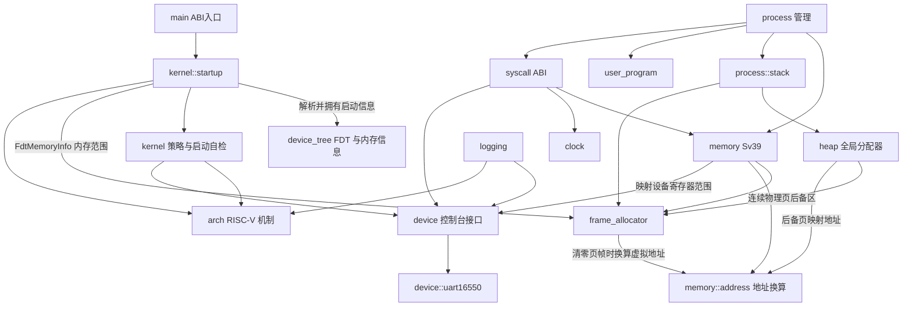

# 模块职责与依赖

本文说明当前代码的职责边界、实际依赖和正在推进的重构方向。它描述现有实现，不把规划中的接口写成已经具备的能力。

## 顶层模块

| 模块 | 职责 | 主要依赖 |
| --- | --- | --- |
| `src/main.rs` | 导出汇编使用的 `kernel_main` 入口并定义 panic handler | `kernel::startup`、RISC-V 架构入口 |
| `src/device_tree` | 校验和遍历 FDT，并在无堆阶段提取内存及早期控制台初始化所需的平台数据 | Rust 核心库 |
| `src/device` | 定义内核使用的设备接口，并提供由启动数据配置的 NS16550 UART 控制台驱动 | QEMU `virt` 的设备 binding 与寄存器约定 |
| `src/arch/riscv64` | 提供低地址启动跳板与早期 Sv39 页表初始化、陷入帧、SBI 和定时器等 RISC-V 机制 | RISC-V 寄存器与固件调用约定 |
| `src/kernel` | 提供分配器、Sv39 地址空间、进程管理、系统调用、日志和用户程序加载策略 | `arch::riscv64` 机制、`device` 接口及 `device_tree` 数据 |
| `kernel::startup` | 解析 FDT 启动信息并配置 UART，先初始化页帧分配器，再由它提供堆后备页，运行启动自检并选择启动模式 | `device_tree`、`device`、分配器、进程和架构初始化接口 |
| `user/` | 独立构建的用户态运行库和示例程序 | Linux RISC-V syscall 约定及用户程序自身逻辑 |

## 内核子模块

| 模块 | 单一职责 | 资源所有权或接口边界 |
| --- | --- | --- |
| `kernel::heap` | 管理内核对象使用的字节堆，并实现全局分配器 | 初始化时从页帧分配器取得连续物理页作为固定堆后备区，通过 `memory` 地址接口取得高半区虚拟地址；为 `Vec` 等 `alloc` 容器提供字节分配 |
| `kernel::frame_allocator` | 根据 FDT 中的 RAM 范围分配和回收物理页帧 | 使用固定 BSS 区间表保存物理范围元数据，不依赖堆；排除内核映像、DTB 和固件保留范围；清零时通过 `memory` 地址接口访问页帧 |
| `kernel::memory` | 定义进程和 syscall 使用的内存接口、映射输入与统一错误类型 | 地址换算和页几何由纯计算子模块直接提供；地址空间机制不拥有用户栈、程序镜像或页表目标页 |
| `kernel::memory::address` | 定义 Sv39 规范地址规则、低半部用户地址上界、内核直接映射及内核映像 VMA/LMA 换算 | 纯地址计算，不访问页表或分配器；调用方负责保证所访问物理范围已映射；内核其他模块直接依赖此模块，不经 `memory` 转发 |
| `kernel::memory::page` | 定义 4 KiB 基础页大小、对齐判断及页边界取整 | 纯算术模块，供页帧分配器、页表、地址空间和进程栈共用；不依赖这些调用方 |
| `kernel::memory::address_space` | 创建、切换、校验和销毁进程的 Sv39 地址空间 | `AddressSpace` 值独占根页表树；单个创建失败时回收部分页表树，通过 `page_table` 建立映射，通过页帧分配器取得和归还页表页 |
| `kernel::memory::page_table` | 编码 Sv39 页表项、建立 4 KiB 映射并激活根页表 | 只管理页表机制；地址空间生命周期由 `address_space` 决定 |
| `kernel::memory::page_table_log` | 遍历现有页表并把映射合并成诊断日志 | 只读页表；不创建或释放映射 |
| `kernel::memory::user_access` | 在短暂设置 `sstatus.SUM` 的窗口内访问已验证的用户地址 | 只执行单次内存读写；范围校验由 syscall 调用路径负责 |
| `kernel::process` | 编排进程创建、用户态陷入、轮转调度和退出资源回收 | 持有追加式 `Vec<Process>` 与稳定 `ProcessId`；每个进程独占 `ProcessResources`，包含地址空间、陷入帧、镜像和两种栈 |
| `kernel::process::creation` | 按顺序准备进程镜像、用户栈、内核栈和独立地址空间，全部成功后发布进程对象 | 从链接器符号读取内核各段范围并组装 `KernelMemoryLayout` 传给 memory；使用局部资源所有者实现失败回滚，页表就绪前不发布进程 |
| `kernel::process::stack` | 分配进程内核栈和用户栈的页帧，并在资源销毁时归还 | 内核栈需要连续页帧并映射到高半区；每张进程页表映射所有可能仍在使用的内核栈，以支持切换期间继续运行；用户栈允许离散页帧；不决定调度策略 |
| `kernel::syscall` | 将 Linux RISC-V syscall 编号和参数转换为当前内核行为 | 负责 ABI 参数与返回值；调用内存、时钟和控制台能力 |
| `kernel::user_program` | 校验构建生成的清单并装载原始用户镜像 | 镜像字节嵌入内核构建产物；运行时从页帧分配器取得镜像页，`LoadedUserProgram` 持有并释放这些页帧 |
| `kernel::clock` | 提供内核启动后的单调时间值 | 读取架构计时源并转换成内核时间值，不定义用户 ABI 布局 |
| `kernel::logging` | 过滤并格式化内核诊断记录 | 通过 `device::console` 输出，并读取平台计时源 |
| `device::console` | 为日志和 syscall 提供字节输入输出及格式化写入接口 | 通过 `ConsoleDevice` 契约调用当前 UART 实现 |
| `device::uart16550` | 轮询访问 FDT 选出的 NS16550 兼容 UART | 启动时提供的 MMIO 范围和 NS16550 寄存器布局 |

## 关键数据类型的归属

结构体按其表达的概念和维护的不变量归属，不按“被谁使用”简单搬进调用方模块。当前主要数据类型如下：

| 类型 | 所属模块 | 归属理由与边界 |
| --- | --- | --- |
| `FdtHeader`、`FdtBlob`、`FdtStructureEvent` | `device_tree::fdt` | 描述 FDT 二进制格式和借用式解析视图；不携带内核策略或分配器状态 |
| `FdtMemoryInfo`、`FdtMemoryInfoError` | `device_tree::memory_info` | 把 FDT 内容整理成启动阶段需要的自有值，并在无堆状态下校验容量和范围 |
| `PhysicalMemoryRegion` | `device_tree::memory_info` | 是 `FdtMemoryInfo` 输出的物理内存范围描述；页帧分配器本就消费 `FdtMemoryInfo`，无需为单个简单值额外建立通用模块 |
| `PhysicalFrame`、`PhysicalFrameRun` | `kernel::frame_allocator` | 表达页帧及连续页帧的独占所有权；只有内核子系统可传递这些令牌 |
| `PageTable` | `kernel::memory::page_table` | 表示与 Sv39 硬件格式对齐的页表页 |
| `UserImageMapping`、`UserStackMapping` | `kernel::memory` | 描述地址空间初始化需要的映射输入；进程拥有镜像和栈，memory 只建立映射 |
| `KernelMemoryLayout`、`KernelSectionRange` | `kernel::memory` | 描述链接器提供的内核各段虚拟和物理边界；memory 校验页对齐及顺序，并按段设置页权限 |
| `KernelStack`、`UserStack`、`Process`、`ProcessState`、`ProcessId`、`ProcessResources` | `kernel::process` 及其 `stack` 子模块 | `Process` 持有身份、父进程、状态和退出码；`ProcessResources` 集中拥有可回收的地址空间、陷入帧、镜像和栈资源 |
| `TrapFrame`、`TaskContext` | `arch::riscv64::trap`、`arch::riscv64::context` | 布局必须与对应汇编偏移一致，属于架构现场机制，不属于调度策略 |
| `MonotonicTime` | `kernel::clock` | 表示内核内部时钟读数，不暴露用户 ABI 布局 |
| `LinuxTimespec`、`SyscallContext`、`SyscallOutcome` | `kernel::syscall` | 将 Linux ABI 表示、用户访问范围和单次调用结果限制在 syscall 边界 |
| `ConsoleDevice`、`MmioRegion` | `device` | 定义字节收发契约和设备寄存器范围；日志、syscall 和页表映射不依赖具体 UART 驱动 |

内核子模块之间的协作接口优先采用父模块范围的可见性（`pub(super)`），仅当入口需要由 crate 根调用、宏展开需要访问，或类型确实构成稳定公共解析接口时才使用更宽可见性。这使调用关系可从模块树看出，并避免把内部资源令牌伪装成通用公共 API。

## 当前依赖关系

箭头表示“左侧调用或使用右侧”。进程在 syscall 分发前提供本次调用可访问的用户地址范围，因此 syscall 不需要反向查询进程表。

## 依赖约定

- 架构模块提供机制，不决定批处理、进程选择或 Linux syscall 行为。
- 页帧分配器管理物理页，不依赖堆、地址空间、进程或用户程序；其元数据使用固定容量区间表，避免堆初始化前的循环依赖。清零页帧时仅依赖 `memory::address` 的纯地址换算，不调用页表生命周期或地址空间接口。
- `memory::address` 负责 Sv39 地址规则与内核地址换算，不验证映射是否已建立。调用方必须根据启动阶段和地址空间契约保证地址可访问；需要地址换算的内核模块直接调用该子模块，不通过 `memory` 增设纯转发函数。
- `memory::page` 只依赖 Rust 核心整数运算，集中维护基础页大小和页对齐规则；堆对象对齐仍由 `kernel::heap` 按其任意对齐语义单独处理。
- 堆只管理对象字节分配，初始化时从页帧分配器取得连续物理页，再以高半区直接映射虚拟地址管理对象；页帧所有权仍由堆持有，堆当前固定为 256 KiB。
- `memory` 管理映射，不拥有映射目标所指向的程序镜像和进程栈页帧；进程页表将 FDT RAM 映射到高半区直接映射窗口，设备 MMIO 范围由设备接口提供并单独映射。
- `process` 决定何时创建、切换、结束和回收进程；`process::stack` 只管理栈页帧所有权。地址空间由 `AddressSpace` 值表达，不再由 memory 模块的全局索引表间接管理。
- `syscall` 是 Linux ABI 边界。ABI 编号和错误码应留在该边界，不散布到调度、内存和设备模块。
- 当两个子系统需要互相调用时，应优先把共享契约放进窄的数据接口，避免继续扩大双向依赖。
- `main` 只负责启动编排；FDT 解析、页表细节和进程状态转换分别留在各自子系统。
- `device_tree::fdt` 只依赖核心库并返回借用式原始视图；`device_tree::memory_info` 在无堆阶段把初始化信息复制到固定容量值中。页帧分配器消费 `FdtMemoryInfo` 中的物理范围，不反向依赖内核分配器或日志。
- `device_tree::console_info` 在无堆阶段从 `/soc` 下提取 NS16550 UART 的寄存器范围；`kernel::startup` 在首次日志输出前把范围交给 `device::console`，解析器不依赖设备驱动，设备驱动也不解析 FDT。
- Linux ABI 的数据布局由 `kernel::syscall` 持有；`kernel::clock` 只返回内部时间值，避免内核机制层依赖 syscall ABI。
- 启动顺序必须先解析并校验 DTB、提取 RAM/固件保留范围和 DTB 自身范围，再初始化页帧分配器，最后从页帧分配器取得堆后备页；页帧分配器的元数据不能通过堆分配。

## 本轮重构与后续边界

早期阶段把原先混合用户态启动与栈生命周期的 `user_mode.rs` 移至进程管理模块，并将栈 backing 收拢到栈子模块；syscall 使用进程分发前提供的地址范围，不再反向查询进程表。页表机制保留在 `kernel::memory`，只读映射诊断拆到 `memory::page_table_log`。启动初始化从 `main.rs` 移入 `kernel::startup`，入口文件只保留 ABI 入口和 panic handler。这些拆分保留既有控制流和资源生命周期。

本轮将 `kernel::memory` 从单文件模块整理为 `memory/mod.rs` 目录模块，以便与已有的页表日志子模块共同组织后续内存职责。进程栈模块仍负责栈的页帧分配、所有权和释放；`memory` 仅接收栈映射描述并建立页表映射，避免把进程资源生命周期移入地址空间机制。

本轮继续将 `memory` 按机制边界拆为 `address_space`、`page_table` 和 `user_access`：前者编排由 `AddressSpace` 值拥有的页表树的创建、切换及销毁；`page_table` 集中处理 Sv39 PTE 和 `satp`；`user_access` 仅封装 SUM 开关与单次用户内存读写。`memory/mod.rs` 保留进程和 syscall 使用的接口、映射输入类型及统一错误说明，页表诊断仍由 `page_table_log` 只读遍历。

本轮新增 `memory::page` 统一 4 KiB 页大小、对齐判断及向上/向下页对齐；页帧分配器、地址空间和进程栈直接使用该叶子模块。Sv39 规范地址转换及用户低半部上界收拢到 `memory::address`，页表诊断也从该处取得规范地址处理。地址换算不再经 `memory/mod.rs` 的转发函数，调用方直接依赖纯计算模块；地址空间创建等有意作为内存子系统接口保留在 `memory` 门面中。

第 32 阶段引入单进程创建器，第 43 阶段移除用户镜像和进程记录的固定数量上限。第 44 阶段将进程记录改为拥有资源的 `Process` 对象：创建器先预留容器容量，再准备镜像、用户栈、内核栈和地址空间，最后一次性发布对象；创建失败时局部所有者回收已取得资源。退出后，调度器先切换地址空间，再回收已退出进程的页表、镜像和用户栈；内核栈延迟到运行在另一栈后释放。最后一个进程退出时，回收器先切换到引导栈和保留的引导页表，再释放最后一组资源。进程 ID 当前只追加、不复用；暂不实现运行时创建、父子关系、`fork`、`wait` 或重用已回收的进程记录。

当前启动入口 `_start` 与引导页表、引导栈位于低地址；引导汇编清零各段的物理装载范围，建立临时 Sv39 映射，再切换到高半区 `kernel_main`。内核 `.text`、`.rodata`、`.data` 和 `.bss` 的 VMA 为 `0xffffffc000000000 + LMA`，并按页边界分别映射为 `SR-X`、`SR--`、`SRW-` 和 `SRW-`。进程页表将 FDT RAM 映射到 `0xffffffc000000000 + PA` 的高半区直接映射窗口，并按高 VMA/低 LMA 映射内核段、启动栈和所有进程内核栈；内核代码、堆、页帧和页表通过高半区虚拟地址访问，物理地址仅用于页表项、`satp` 和资源记录。共享内核栈映射使调度器切换 `satp` 后仍能完成当前陷入处理。动态分配的用户镜像页和用户栈分别映射为 `URWX`、`URW-`，仍位于 Sv39 低半部；用户镜像共同虚拟基址为 `0x40000000`，镜像物理页由进程拥有且可以不连续。`make inspect-kernel-elf` 检查低地址入口、启动段恒等布局及内核主体 VMA/LMA 偏移。临时启动页表按 QEMU `virt` 的单 hart、128 MiB RAM 环境用 1 GiB 叶子覆盖低设备窗口、RAM 低地址和高半区别名；进程页表不再建立 RAM 低地址恒等映射，UART MMIO 仍按设备物理地址单独映射。

此前将原先过于宽泛的 `boot` 顶层模块重命名为 `device_tree`，并把 `info.rs` 明确命名为 `memory_info.rs`；启动编排仍属于 `kernel::startup`。QEMU UART 已从 `arch::riscv64` 移至独立的 `device` 模块：`ConsoleDevice` 表达内核所需的最小字节收发契约，日志和 syscall 通过 `device::console` 使用该接口，具体 NS16550 寄存器访问集中在 `device::uart16550`。本轮再由 `device_tree::console_info` 读取 QEMU `virt` FDT 中 `/soc` 子设备的 UART `reg` 范围，启动阶段先完成这项解析和控制台初始化，再输出日志；UART 物理地址不再写死在驱动中。当前仍只支持空 `ranges` 的 `/soc` 和 NS16550 兼容设备，尚未解析 `/chosen/stdout-path`、总线地址转换或建立通用设备发现/注册框架。另继续明确数据与机制/ABI 的归属：`PhysicalMemoryRegion` 留在 `device_tree::memory_info`，时钟返回内核自己的 `MonotonicTime`，Linux `timespec` 布局留在 syscall 边界。没有为了文件大小进行机械拆分，页表映射契约仍由 `kernel::memory` 统一维护，进程对象拥有自己的栈和镜像资源。

当前仍有明确的重构工作：

1. 地址空间规划已记录在第 33 阶段；第 34 阶段分离用户镜像虚拟地址与 RAM 恒等映射，第 35 阶段按页边界落实内核段权限，第 41 阶段实现低地址入口、早期 Sv39 映射及高 VMA/低 LMA 内核主体。进程页表按 FDT 描述的 RAM 建立高半区直接映射，低地址 RAM 恒等映射只保留在启动页表中；后续可继续审查启动阶段低地址映射的范围和权限。
2. 第 44 阶段已将进程运行资源集中到可回收的内核对象，并建立最后一个进程退出后的安全回收上下文。退出状态暂时保存在追加式进程记录中，没有父进程来收集状态；下一步可在这一对象与生命周期基础上实现最小 `clone`/fork 创建语义，再讨论父子状态和 `wait`。可同时存活的进程数量由页帧和内核堆容量决定；页帧分配器的固定范围表仍有独立的内存拓扑元数据容量约束。
3. 当前设备接口只覆盖轮询式 UART 控制台；增加其他设备前，再根据实际消费者扩展设备类别与发现/初始化接口，避免提前建立通用驱动框架。
4. 页帧分配器目前按页扫描 FDT RAM 范围并用固定容量区间表追踪可用区；尚未解析 `/reserved-memory`、建立通用虚拟堆窗口或按需扩展堆。

每项后续改动应单独说明它移除的依赖或表达的不变量，并随接口变化更新本页。
