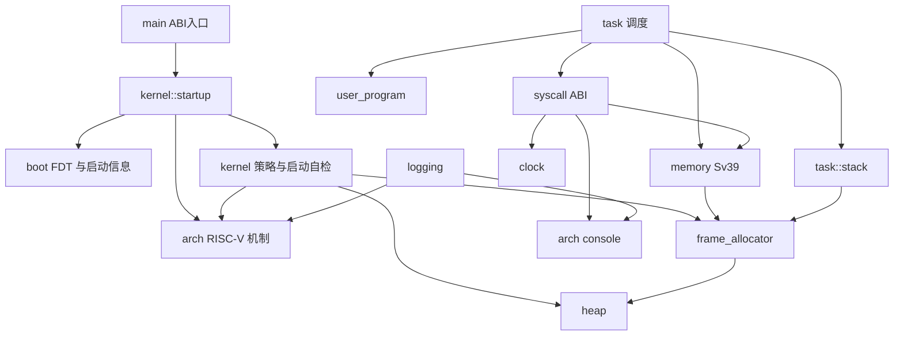

# 模块职责与依赖

本文说明当前代码的职责边界、实际依赖和正在推进的重构方向。它描述现有实现，不把规划中的接口写成已经具备的能力。

## 顶层模块

| 模块 | 职责 | 主要依赖 |
| --- | --- | --- |
| `src/main.rs` | 导出汇编使用的 `kernel_main` 入口并定义 panic handler | `kernel::startup`、RISC-V 架构入口 |
| `src/boot` | 以借用方式解析 FDT，并提取启动所需的内存和保留区域信息 | Rust 核心库 |
| `src/arch/riscv64` | 提供启动汇编、陷入帧、SBI、定时器、UART 等 RISC-V/QEMU 机制 | RISC-V 寄存器与固件调用约定 |
| `src/kernel` | 提供分配器、Sv39 地址空间、任务调度、系统调用、日志和用户程序加载策略 | `arch::riscv64` 机制及 `boot` 数据 |
| `kernel::startup` | 按启动顺序初始化内核资源，解析 FDT、运行启动自检、输出启动摘要并选择启动模式 | `boot`、分配器、任务和架构初始化接口 |
| `user/` | 独立构建的用户态运行库和示例程序 | Linux RISC-V syscall 约定及用户程序自身逻辑 |

## 内核子模块

| 模块 | 单一职责 | 资源所有权或接口边界 |
| --- | --- | --- |
| `kernel::heap` | 管理内核对象使用的字节堆，并实现全局分配器 | 拥有静态堆区；为 `Vec` 等 `alloc` 容器提供字节分配 |
| `kernel::frame_allocator` | 从固定物理页池分配、清零和回收页帧 | 页帧以 `PhysicalFrame` 所有权值交给调用方；不管理堆对象 |
| `kernel::memory` | 创建、切换、遍历和回收 Sv39 地址空间；执行受校验的用户内存访问 | 页表页由页帧分配器提供；叶子映射所指向的任务栈和镜像由任务/加载器持有 |
| `kernel::memory::page_table_log` | 遍历现有页表并把映射合并成诊断日志 | 只读页表；不创建或释放映射 |
| `kernel::task` | 创建启动任务、处理任务陷入现场、轮转调度和退出回收 | 持有任务记录；依赖栈资源、地址空间、系统调用和架构陷入/SBI 接口 |
| `kernel::task::stack` | 分配任务内核栈和用户栈的页帧，并在资源销毁时归还 | 内核栈需要连续页帧；用户栈允许离散页帧；不决定调度策略 |
| `kernel::syscall` | 将 Linux RISC-V syscall 编号和参数转换为当前内核行为 | 负责 ABI 参数与返回值；调用内存、时钟和控制台能力 |
| `kernel::user_program` | 校验构建生成的清单并装载原始用户镜像 | 镜像来自构建产物；当前目标物理槽位固定 |
| `kernel::clock` | 提供内核启动后的单调时间和 `timespec` 表示 | 读取架构计时源并转换成内核时间值 |
| `kernel::logging` | 过滤并格式化内核诊断记录 | 通过架构 console 输出，并读取平台计时源 |

## 当前依赖关系

箭头表示“左侧调用或使用右侧”。任务在 syscall 分发前提供本次调用可访问的用户地址范围，因此 syscall 不需要反向查询任务表。

## 依赖约定

- 架构模块提供机制，不决定批处理、任务选择或 Linux syscall 行为。
- 页帧分配器管理物理页，不依赖地址空间、任务或用户程序。
- `memory` 管理映射，不拥有映射目标所指向的程序镜像和任务栈页帧。
- `task` 决定何时创建、切换和结束任务；栈模块只管理栈页帧所有权。
- `syscall` 是 Linux ABI 边界。ABI 编号和错误码应留在该边界，不散布到调度、内存和设备模块。
- 当两个子系统需要互相调用时，应优先把共享契约放进窄的数据接口，避免继续扩大双向依赖。
- `main` 只负责启动编排；FDT 解析、页表细节和任务状态转换分别留在各自子系统。

## 本轮重构与后续边界

本轮把原先混合任务调度与栈生命周期的 `user_mode.rs` 移至 `kernel::task`，并将栈 backing 收拢到 `task::stack`；syscall 使用任务分发前提供的地址范围，不再反向查询任务表。页表机制保留在 `kernel::memory`，只读映射诊断拆到 `memory::page_table_log`。启动初始化从 `main.rs` 移入 `kernel::startup`，入口文件只保留 ABI 入口和 panic handler。这些拆分保留既有控制流和资源生命周期。

当前仍有明确的重构工作：

1. 在运行时任务创建成为目标后，再以拥有资源的管理对象替代任务表、当前索引和待回收栈等可变全局状态；需保留单 hart、中断和活动栈不变量。
2. 在出现文件描述符、设备抽象等真实消费者后，再设计内核控制台/I/O 接口；避免当前只为转发 UART 调用而增加空壳层。

每项后续改动应单独说明它移除的依赖或表达的不变量，并随接口变化更新本页。
