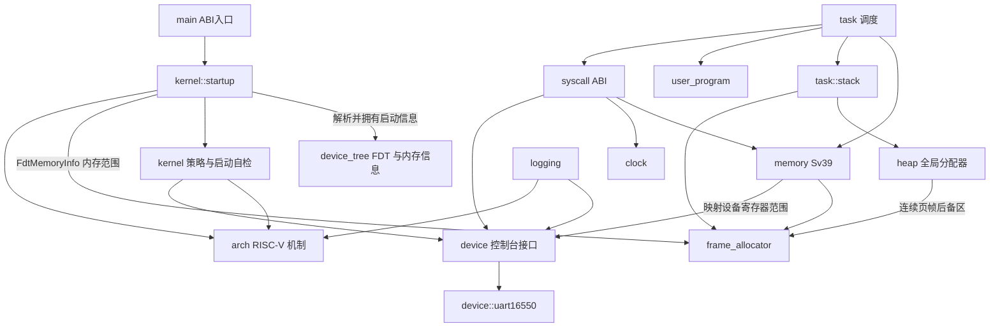

# 模块职责与依赖

本文说明当前代码的职责边界、实际依赖和正在推进的重构方向。它描述现有实现，不把规划中的接口写成已经具备的能力。

## 顶层模块

| 模块 | 职责 | 主要依赖 |
| --- | --- | --- |
| `src/main.rs` | 导出汇编使用的 `kernel_main` 入口并定义 panic handler | `kernel::startup`、RISC-V 架构入口 |
| `src/device_tree` | 校验和遍历 FDT，并在无堆阶段提取内存及早期控制台初始化所需的平台数据 | Rust 核心库 |
| `src/device` | 定义内核使用的设备接口，并提供由启动数据配置的 NS16550 UART 控制台驱动 | QEMU `virt` 的设备 binding 与寄存器约定 |
| `src/arch/riscv64` | 提供启动汇编、陷入帧、SBI 和定时器等 RISC-V 机制 | RISC-V 寄存器与固件调用约定 |
| `src/kernel` | 提供分配器、Sv39 地址空间、任务调度、系统调用、日志和用户程序加载策略 | `arch::riscv64` 机制、`device` 接口及 `device_tree` 数据 |
| `kernel::startup` | 解析 FDT 启动信息并配置 UART，先初始化页帧分配器，再由它提供堆后备页，运行启动自检并选择启动模式 | `device_tree`、`device`、分配器、任务和架构初始化接口 |
| `user/` | 独立构建的用户态运行库和示例程序 | Linux RISC-V syscall 约定及用户程序自身逻辑 |

## 内核子模块

| 模块 | 单一职责 | 资源所有权或接口边界 |
| --- | --- | --- |
| `kernel::heap` | 管理内核对象使用的字节堆，并实现全局分配器 | 初始化时从页帧分配器取得连续页帧作为固定堆后备区；为 `Vec` 等 `alloc` 容器提供字节分配 |
| `kernel::frame_allocator` | 根据 FDT 中的 RAM 范围分配、清零和回收页帧 | 使用固定 BSS 区间表保存元数据，不依赖堆；排除内核映像、用户程序槽、DTB 和固件保留范围；页帧以所有权值交给调用方 |
| `kernel::memory` | 汇总地址空间、页表和用户内存访问接口；定义映射输入与统一错误类型 | 对任务和 syscall 提供窄接口，不直接拥有用户栈、程序镜像或页表目标页 |
| `kernel::memory::address_space` | 逐个创建、切换、校验和销毁任务的 Sv39 地址空间 | 持有根页表索引；单个创建失败时回收部分页表树，通过 `page_table` 建立映射，通过页帧分配器取得和归还页表页 |
| `kernel::memory::page_table` | 编码 Sv39 页表项、建立 4 KiB 映射并激活根页表 | 只管理页表机制；地址空间生命周期由 `address_space` 决定 |
| `kernel::memory::page_table_log` | 遍历现有页表并把映射合并成诊断日志 | 只读页表；不创建或释放映射 |
| `kernel::memory::user_access` | 在短暂设置 `sstatus.SUM` 的窗口内访问已验证的用户地址 | 只执行单次内存读写；范围校验由 syscall 调用路径负责 |
| `kernel::task` | 编排单任务创建、处理任务陷入现场、轮转调度和退出回收 | 持有追加式任务记录及稳定 `TaskId`；依赖任务创建器、栈资源、地址空间、系统调用和架构陷入/SBI 接口 |
| `kernel::task::creation` | 按顺序取得一个用户任务所需的镜像、用户栈、内核栈和独立地址空间，全部成功后发布任务记录 | 从链接器符号读取完整内核映射范围并传给 memory；使用局部资源所有者实现失败回滚，页表就绪前不发布任务 |
| `kernel::task::stack` | 分配任务内核栈和用户栈的页帧，并在资源销毁时归还 | 内核栈需要连续页帧；用户栈允许离散页帧；不决定调度策略 |
| `kernel::syscall` | 将 Linux RISC-V syscall 编号和参数转换为当前内核行为 | 负责 ABI 参数与返回值；调用内存、时钟和控制台能力 |
| `kernel::user_program` | 校验构建生成的清单并装载原始用户镜像 | 镜像来自构建产物；目标物理槽位由链接器固定预留，装载前清零并覆盖 |
| `kernel::clock` | 提供内核启动后的单调时间值 | 读取架构计时源并转换成内核时间值，不定义用户 ABI 布局 |
| `kernel::logging` | 过滤并格式化内核诊断记录 | 通过 `device::console` 输出，并读取平台计时源 |
| `device::console` | 为日志和 syscall 提供字节输入输出及格式化写入接口 | 通过 `ConsoleDevice` 契约调用当前 UART 实现 |
| `device::uart16550` | 轮询访问 FDT 选出的 NS16550 兼容 UART | 启动时提供的 MMIO 范围和 NS16550 寄存器布局 |

## 关键数据类型的归属

结构体按其表达的概念和维护的不变量归属，不按“被谁使用”简单搬进调用方模块。当前主要数据类型如下：

| 类型 | 所属模块 | 归属理由与边界 |
| --- | --- | --- |
| `FdtHeader`、`FdtBlob`、`FdtStructureEvent` | `device_tree::fdt` | 描述 FDT 二进制格式和借用式解析视图；不携带内核策略或分配器状态 |
| `FdtMemoryInfo`、`FdtMemoryInfoError` | `device_tree::memory_info` | 把 FDT 内容整理成启动阶段需要的自有值，并在无堆状态下校验容量和范围 |
| `PhysicalMemoryRegion` | `device_tree::memory_info` | 是 `FdtMemoryInfo` 输出的物理内存范围描述；页帧分配器本就消费 `FdtMemoryInfo`，无需为单个简单值额外建立通用模块 |
| `PhysicalFrame`、`PhysicalFrameRun` | `kernel::frame_allocator` | 表达页帧及连续页帧的独占所有权；只有内核子系统可传递这些令牌 |
| `PageTable` | `kernel::memory::page_table` | 表示与 Sv39 硬件格式对齐的页表页 |
| `UserImageMapping`、`UserStackMapping` | `kernel::memory` | 描述地址空间初始化需要的映射输入；任务拥有镜像和栈，memory 只建立映射 |
| `KernelStack`、`UserStack`、`Task`、`TaskState` | `kernel::task` 及其 `stack` 子模块 | 任务持有执行状态；stack 子模块单独封装栈页帧所有权与回收 |
| `TrapFrame`、`TaskContext` | `arch::riscv64::trap`、`arch::riscv64::context` | 布局必须与对应汇编偏移一致，属于架构现场机制，不属于调度策略 |
| `MonotonicTime` | `kernel::clock` | 表示内核内部时钟读数，不暴露用户 ABI 布局 |
| `LinuxTimespec`、`SyscallContext`、`SyscallOutcome` | `kernel::syscall` | 将 Linux ABI 表示、用户访问范围和单次调用结果限制在 syscall 边界 |
| `ConsoleDevice`、`MmioRegion` | `device` | 定义字节收发契约和设备寄存器范围；日志、syscall 和页表映射不依赖具体 UART 驱动 |

内核子模块之间的协作接口优先采用父模块范围的可见性（`pub(super)`），仅当入口需要由 crate 根调用、宏展开需要访问，或类型确实构成稳定公共解析接口时才使用更宽可见性。这使调用关系可从模块树看出，并避免把内部资源令牌伪装成通用公共 API。

## 当前依赖关系

箭头表示“左侧调用或使用右侧”。任务在 syscall 分发前提供本次调用可访问的用户地址范围，因此 syscall 不需要反向查询任务表。

## 依赖约定

- 架构模块提供机制，不决定批处理、任务选择或 Linux syscall 行为。
- 页帧分配器管理物理页，不依赖堆、地址空间、任务或用户程序；其元数据使用固定容量区间表，避免堆初始化前的循环依赖。
- 堆只管理对象字节分配，初始化时从页帧分配器取得连续页帧；页帧仍由堆持有，堆当前固定为 256 KiB。
- `memory` 管理映射，不拥有映射目标所指向的程序镜像和任务栈页帧；设备 MMIO 范围由设备接口提供，页表模块不复制 UART 地址常量。
- `task` 决定何时创建、切换和结束任务；栈模块只管理栈页帧所有权。
- `syscall` 是 Linux ABI 边界。ABI 编号和错误码应留在该边界，不散布到调度、内存和设备模块。
- 当两个子系统需要互相调用时，应优先把共享契约放进窄的数据接口，避免继续扩大双向依赖。
- `main` 只负责启动编排；FDT 解析、页表细节和任务状态转换分别留在各自子系统。
- `device_tree::fdt` 只依赖核心库并返回借用式原始视图；`device_tree::memory_info` 在无堆阶段把初始化信息复制到固定容量值中。页帧分配器消费 `FdtMemoryInfo` 中的物理范围，不反向依赖内核分配器或日志。
- `device_tree::console_info` 在无堆阶段从 `/soc` 下提取 NS16550 UART 的寄存器范围；`kernel::startup` 在首次日志输出前把范围交给 `device::console`，解析器不依赖设备驱动，设备驱动也不解析 FDT。
- Linux ABI 的数据布局由 `kernel::syscall` 持有；`kernel::clock` 只返回内部时间值，避免内核机制层依赖 syscall ABI。
- 启动顺序必须先解析并校验 DTB、提取 RAM/固件保留范围和 DTB 自身范围，再初始化页帧分配器，最后从页帧分配器取得堆后备页；页帧分配器的元数据不能通过堆分配。

## 本轮重构与后续边界

本轮把原先混合任务调度与栈生命周期的 `user_mode.rs` 移至 `kernel::task`，并将栈 backing 收拢到 `task::stack`；syscall 使用任务分发前提供的地址范围，不再反向查询任务表。页表机制保留在 `kernel::memory`，只读映射诊断拆到 `memory::page_table_log`。启动初始化从 `main.rs` 移入 `kernel::startup`，入口文件只保留 ABI 入口和 panic handler。这些拆分保留既有控制流和资源生命周期。

本轮将 `kernel::memory` 从单文件模块整理为 `memory/mod.rs` 目录模块，以便与已有的页表日志子模块共同组织后续内存职责。`task::stack` 仍负责任务栈的页帧分配、所有权和释放；`memory` 仅接收栈映射描述并建立页表映射，避免把任务资源生命周期移入地址空间机制。

本轮继续将 `memory` 按机制边界拆为 `address_space`、`page_table` 和 `user_access`：前者拥有地址空间根表记录并编排创建、切换及销毁；`page_table` 集中处理 Sv39 PTE 和 `satp`；`user_access` 仅封装 SUM 开关与单次用户内存读写。`memory/mod.rs` 保留任务和 syscall 使用的接口、映射输入类型及统一错误说明，页表诊断仍由 `page_table_log` 只读遍历。

本阶段新增 `task::creation`，把批处理和 shell 启动共用的单任务准备流程收拢起来。创建器先预留任务表容量，再依次装载程序镜像、分配用户栈、分配内核栈和建立该任务的页表；所有步骤成功后才追加带 `TaskId` 的任务记录。`UserStack` 和 `KernelStack` 在任务记录发布前由局部所有者持有，错误返回时自动释放；页表创建器负责清理未完成的页表树。用户镜像槽是链接器固定预留的物理区域，不是动态分配的页帧；创建失败后槽位可直接复用，下一次装载会先清零再复制，不通过不安全的虚拟地址别名在 Drop 中清理。批处理和 shell 仍只在启动期创建任务，本阶段没有加入 shell 命令、任务复用或并发同镜像实例。

此前将原先过于宽泛的 `boot` 顶层模块重命名为 `device_tree`，并把 `info.rs` 明确命名为 `memory_info.rs`；启动编排仍属于 `kernel::startup`。QEMU UART 已从 `arch::riscv64` 移至独立的 `device` 模块：`ConsoleDevice` 表达内核所需的最小字节收发契约，日志和 syscall 通过 `device::console` 使用该接口，具体 NS16550 寄存器访问集中在 `device::uart16550`。本轮再由 `device_tree::console_info` 读取 QEMU `virt` FDT 中 `/soc` 子设备的 UART `reg` 范围，启动阶段先完成这项解析和控制台初始化，再输出日志；UART 物理地址不再写死在驱动中。当前仍只支持空 `ranges` 的 `/soc` 和 NS16550 兼容设备，尚未解析 `/chosen/stdout-path`、总线地址转换或建立通用设备发现/注册框架。另继续明确数据与机制/ABI 的归属：`PhysicalMemoryRegion` 留在 `device_tree::memory_info`，时钟返回内核自己的 `MonotonicTime`，Linux `timespec` 布局留在 syscall 边界。没有为了文件大小进行机械拆分，页表映射契约仍由 `kernel::memory` 统一维护，任务仍拥有自己的栈和镜像资源。

当前仍有明确的重构工作：

1. 单任务创建现已具备事务式准备和失败回滚，但创建仍只发生在启动期，任务表上限为 8，镜像仍使用固定槽位。要支持 shell 前台 `run`，下一步需把创建器接入运行期，并明确运行中任务与 shell 的调度、退出回收及固定镜像槽的占用约束；再评估将任务表、当前索引和待回收栈收拢到拥有资源的管理对象，保留单 hart、中断和活动栈不变量。
2. 当前设备接口只覆盖轮询式 UART 控制台；增加其他设备前，再根据实际消费者扩展设备类别与发现/初始化接口，避免提前建立通用驱动框架。
3. 页帧分配器目前按页扫描 FDT RAM 范围并用固定容量区间表追踪可用区；尚未解析 `/reserved-memory`、建立通用虚拟堆窗口或按需扩展堆。

每项后续改动应单独说明它移除的依赖或表达的不变量，并随接口变化更新本页。
